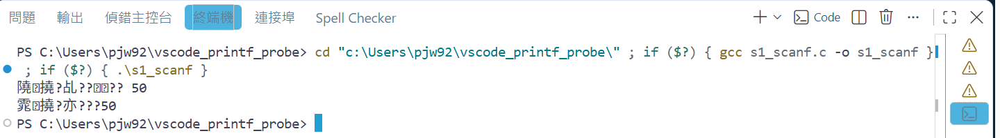
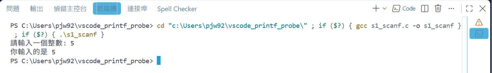
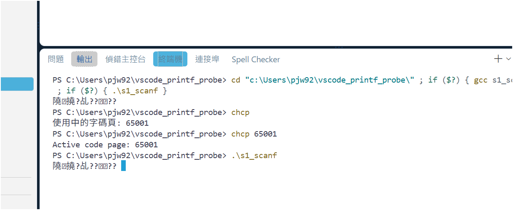
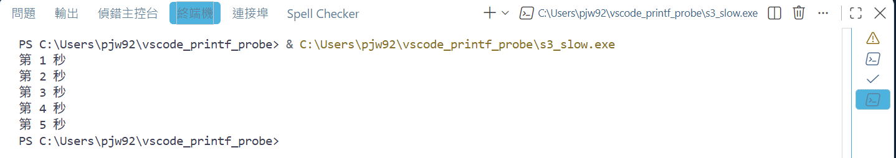

在 VS Code 的終端機執行程式，中文變成一堆看不懂的字：



程式沒寫錯，是**終端機讀錯了文字的編碼**。

## 先改設定

1. 按 `Ctrl+Shift+P`，輸入 `開啟使用者設定 (JSON)`（英文介面是 `Open User Settings (JSON)`），按 Enter。
2. 會打開一個叫 `settings.json` 的檔案，內容是一對大括號 `{ }`，裡面有幾行設定。
3. 把下面這段**整段複製**，貼在**最後一個 `}` 的前一行**：

```json
	"terminal.integrated.profiles.windows": {
		"PowerShell": {
			"source": "PowerShell",
			"icon": "terminal-powershell",
			"args": ["-NoExit", "-Command", "[Console]::OutputEncoding = [Text.Encoding]::UTF8; chcp 65001 > $null"]
		}
	},
	"terminal.integrated.defaultProfile.windows": "PowerShell",
```

4. 檢查**貼上位置的上一行**結尾有沒有逗號 `,`，沒有的話補一個。
5. 按 `Ctrl+S` 存檔。
6. 到下方「終端機」分頁，按右上角的**垃圾桶**把終端機全部關掉（設定只對新開的終端機有效）。
7. 再執行一次程式，中文就正常了。



貼上去的那段縮排歪了也沒關係，VS Code 不看縮排，只看括號和逗號。

**貼錯了怎麼辦？** 檔案裡出現紅色波浪底線，代表格式有錯，最常見的是少了逗號。把滑鼠移到紅線上會顯示原因；或是把剛貼的那段刪掉，重新照步驟 3、4 貼一次。

## 為什麼會這樣？

電腦裡的文字都是一串數字，**編碼**決定這串數字代表哪個字。同樣的數字，用不同的編碼去讀，就會讀成不同的字。

- 你在 VS Code 寫的程式是 **UTF-8** 編碼，`printf` 印出來的中文也是 UTF-8。
- 中文版 Windows 的終端機預設用 **Big5**（代號 950）來讀。

用 Big5 去讀 UTF-8 的字，就變成亂碼。上面那段設定的意思是：「終端機一打開，就改成用 UTF-8 來讀」。

## 為什麼只打 `chcp 65001` 沒用？

網路上常教在終端機打 `chcp 65001`（切換成 UTF-8）。在 VS Code 的終端機裡打完，`chcp` 也顯示 65001，**但執行程式還是亂碼**：



因為 VS Code 的終端機跑的是 **PowerShell**。PowerShell 自己另外記了一份編碼，每次執行程式前，會用它記住的那份（還是 Big5）把終端機改回去。所以要改的是 PowerShell 記住的那份，也就是設定裡的 `[Console]::OutputEncoding = [Text.Encoding]::UTF8`。

## 其他執行方式也會這樣嗎？

我們在 Windows（MSYS2 UCRT64 的 gcc、VS Code C/C++ 擴充套件）實際測過：

| 怎麼執行 | 改設定前 | 改設定後 |
|---|---|---|
| Code Runner 的 Run Code（在終端機執行） | 亂碼 | 正常 |
| `Ctrl+Shift+P` →「C/C++: Run C/C++ File」 | 亂碼 | 正常 |
| 按 F5 除錯 | 正常 | 正常 |



## 網路上還有一種做法：編譯時加 `-fexec-charset=BIG5`

這會把程式裡所有中文字串改成 Big5，終端機用 Big5 讀就正常了。但我們實測有副作用：程式裡**所有**中文字串都會變成 Big5，**連寫進檔案的中文也是**。所以不建議，改設定就好。
