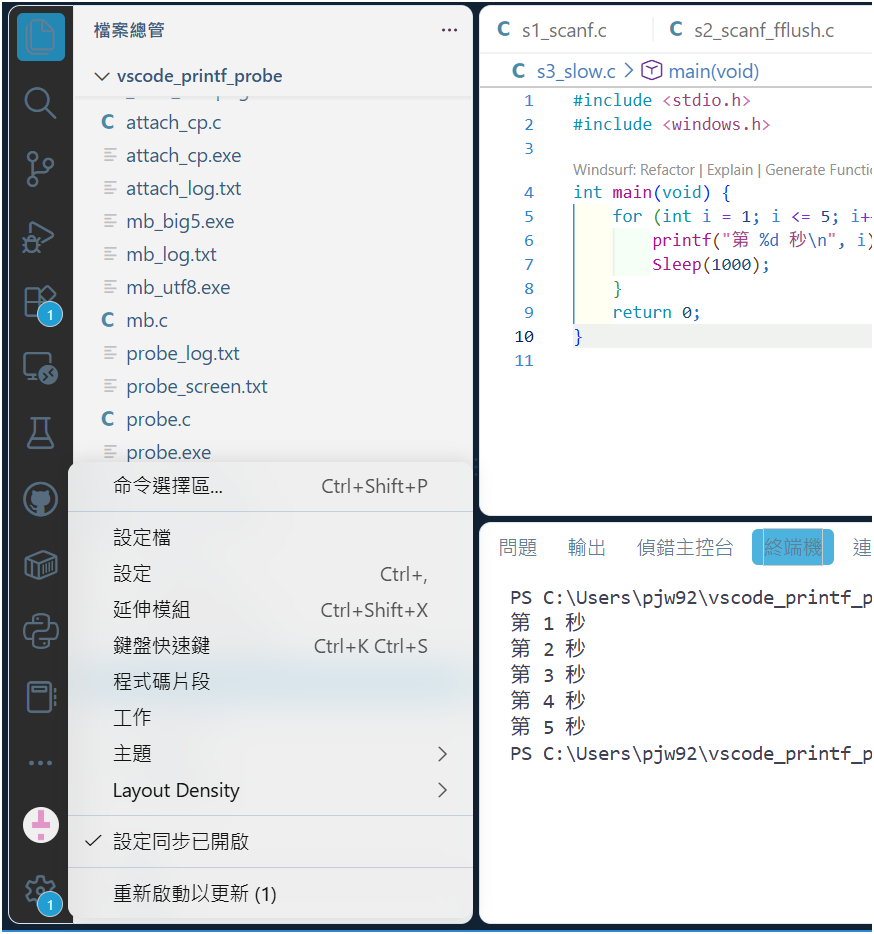
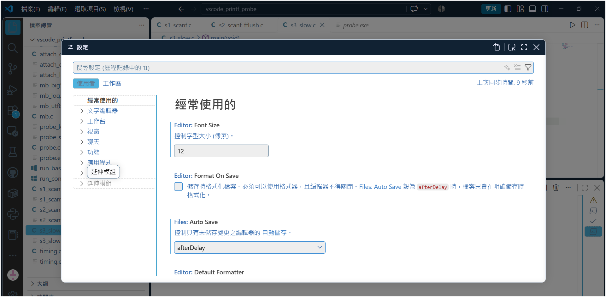
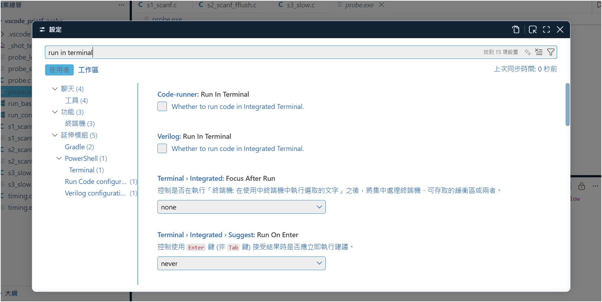
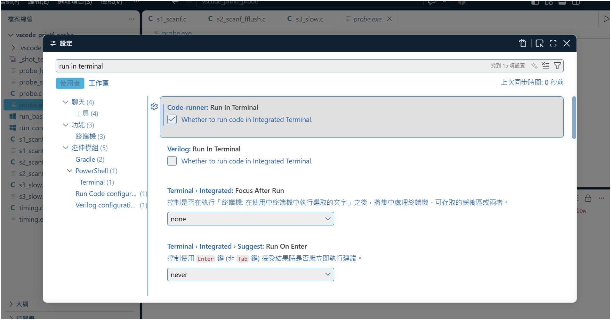
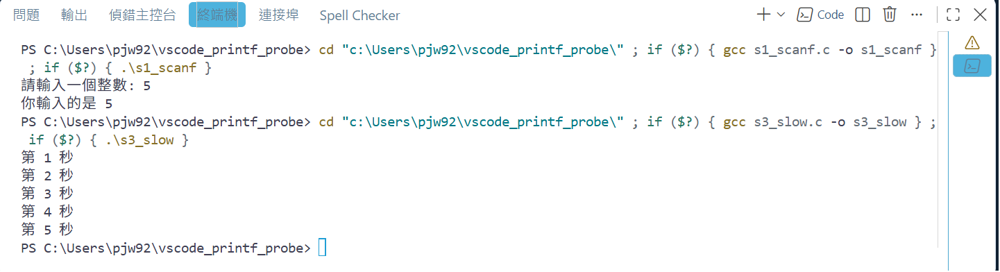
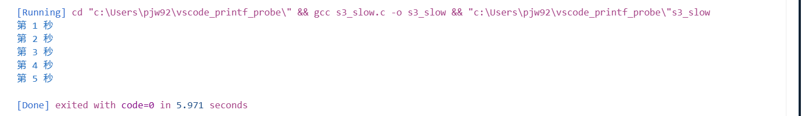
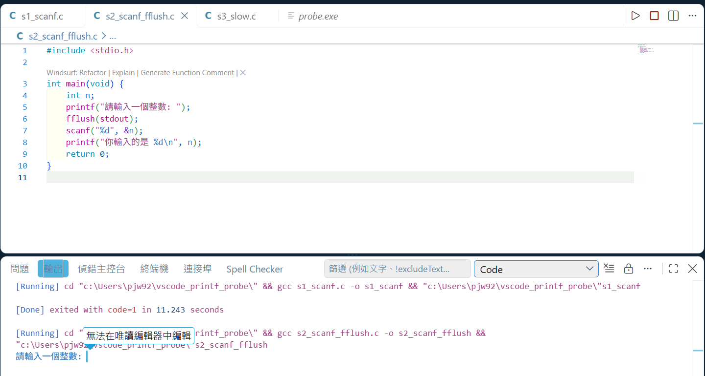

在 VS Code 按右鍵選 **Run Code**（或按 `Ctrl+Alt+N`）執行下面這支程式：

```c
#include <stdio.h>

int main(void) {
	int score;
	printf("請輸入成績: ");
	scanf("%d", &score);
	printf("你的成績是 %d\n", score);
	return 0;
}
```

結果下方的「輸出」面板只出現一行 `[Running] ...`，**「請輸入成績」沒有出現，程式也一直不結束**。

![輸出面板只有 [Running]，編輯器右上角的紅色方塊亮著，程式卡住](截圖/printf/A_輸出面板_s1卡住.png)

程式沒寫錯。這是 **Code Runner 擴充套件的預設設定**造成的，改一個設定就好。

## 先改設定：讓程式在「終端機」裡跑

先把卡住的那支程式停掉：按編輯器右上角的**紅色方塊**。沒停掉的話，舊的程式還在背景佔著執行檔，改完設定重新執行會出現 `Permission denied`。

1. 點左下角的**齒輪**，選「**設定**」。（也可以按 `Ctrl+,`，或從上方選單 **檔案 → 喜好設定 → 設定**。）
2. 最上面的搜尋框輸入 `run in terminal`。
3. 找到 **Code-runner: Run In Terminal**，把它**打勾**。
4. 回到程式，再按一次 `Ctrl+Alt+N`。









這次程式會在下方的「**終端機**」分頁執行：「請輸入成績」馬上出現，打數字按 Enter，就會印出結果。



> 如果終端機裡的中文變成亂碼，那是另一個問題，請看〈VS Code 終端機裡的中文變亂碼？〉。

設定只要改一次，之後每支程式都會在終端機執行。

## 為什麼會這樣？

Code Runner 預設把程式的輸出送到「**輸出**」面板。這個面板有兩個特性：

- **它只能看，不能打字。** 程式執行到 `scanf` 時在等你輸入，可是你打的字送不進程式，所以程式永遠等下去。
- **字不會馬上出現。** `printf` 印的字會先放在程式裡的一個暫存區（叫做**緩衝區**），等裝滿了或程式結束時，才一次送出去。如果是送到終端機，字會立刻出現；但送到輸出面板時，就會一直放在緩衝區裡。

所以「請輸入成績」還在緩衝區裡，程式又卡在 `scanf` 等輸入，畫面上就什麼都沒有。

這跟有沒有換行無關。下面這支程式每秒印一行，每一行都有 `\n`：

```c
#include <stdio.h>
#include <windows.h>

int main(void) {
	for (int i = 1; i <= 5; i++) {
		printf("第 %d 秒\n", i);
		Sleep(1000);
	}
	return 0;
}
```

- 在**終端機**執行：每秒出現一行。
- 在**輸出面板**執行：前 5 秒什麼都沒有，程式結束時 5 行一次跳出來。



## 網路上說加 `fflush(stdout)`，可以嗎？

`fflush(stdout)` 的意思是「現在就把緩衝區的字送出去」。先講結論：**在終端機執行時不需要它；在輸出面板執行時加了也沒用。**

**在終端機執行（改過設定之後）**：不用加。終端機會把字馬上顯示出來，上面那支沒有 `fflush` 的程式，提示字照樣出現、也能輸入。

**在輸出面板執行（沒改設定）**：在 `printf` 後面加上 `fflush`：

```c
printf("請輸入成績: ");
fflush(stdout);
scanf("%d", &score);
```

「請輸入成績」確實出現了，可是你一打字，VS Code 就跳出「**無法在唯讀編輯器中編輯**」，數字送不進程式，程式一樣卡住。



這是因為輸出面板**本來就不能打字**，跟有沒有 `fflush` 無關。`fflush` 只解決了「看不到提示字」，解決不了「沒辦法輸入」：

| 在輸出面板執行 | 提示字 | 能不能輸入 |
|---|---|---|
| 沒有 `fflush` | 不出現（還在緩衝區） | 不能 |
| 有 `fflush` | 出現 | **還是不能** |

所以**程式只要用到 `scanf`，就要改設定**，加 `fflush` 沒有用。

## 卡住的程式要怎麼停？

- **在「輸出」面板卡住**：按編輯器右上角的**紅色方塊**（程式執行中才會出現）。我們實測過，按 `Ctrl+Alt+M` 停不了。
- **在「終端機」卡住**（勾了 Run In Terminal 以後）：點一下終端機，按 `Ctrl+C`。

沒停掉就重新執行的話，舊的程式還在背景佔著執行檔，編譯會出現 `Permission denied`。

## 其他執行方式也會這樣嗎？

我們在 Windows（MSYS2 UCRT64 的 gcc、VS Code C/C++ 擴充套件）實際測過：

| 怎麼執行 | 會不會卡住 |
|---|---|
| Code Runner 的 Run Code（**預設**） | **會** |
| Code Runner 的 Run Code（勾了 Run In Terminal） | 不會 |
| 按 F5 除錯 | 不會 |
| 編輯器右上角 ▶ 的「Run C/C++ File」 | 不會 |

## 檢查清單

- [ ] 用 Run Code 執行時，程式是在「**終端機**」分頁跑，不是「輸出」分頁？
- [ ] 如果是在「輸出」分頁：設定裡的 **Code-runner: Run In Terminal** 打勾了嗎？
- [ ] 卡住的程式先停掉（輸出面板按紅色方塊，終端機按 `Ctrl+C`），再重新執行。
