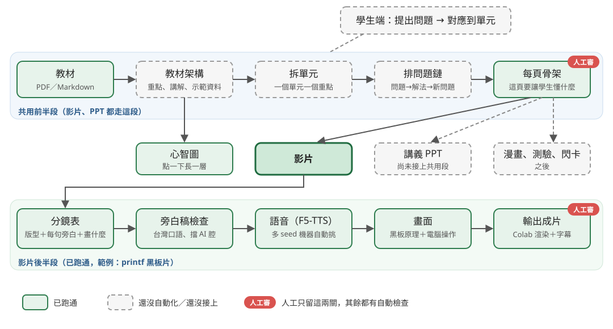

# 多元教材：影片製作流程說明

整理日期：2026-10-28。給 BridgeAI 平台使用；平台整體設計另見 `docs/PLATFORM_FLOW.md`。

## 一、這個專案在做什麼

把老師的教材（PDF、Markdown）轉成多種形式的教材：**影片、講義 PPT、心智圖**，之後也可以延伸到漫畫、測驗、閃卡。分成兩條使用路線：

| | 老師端 | 學生端 |
| --- | --- | --- |
| 輸入 | 一整份教材（可能好幾頁 PDF） | 學生讀教材時提出的問題 |
| 過程 | 先給內容架構或樣本預覽，老師確認、調整後才完整輸出 | 不經過人工審稿，系統先理解「學生到底在問什麼」 |
| 產出 | 完整影片、講義 PPT、心智圖 | 30–100 秒短影片、小漫畫或小 PPT；心智圖標出「你的問題在這個分支」 |

## 二、整體流程



```
教材（PDF／Markdown）
  → 教材架構：整理成 AI 讀得懂的重點、講解、示範資料
      ├─→ 心智圖：直接從整份架構產生（呈現全貌）
  → 拆單元：一個單元一個重點，約 40–60 秒
  → 排問題鏈：每個單元回答上一個單元留下的問題
  → 每頁一句話骨架：這頁要讓學生懂什麼          ← 影片、PPT 共用到這裡
      ├─→ 影片：分鏡 → 旁白 → 語音 → 畫面 → 成片
      ├─→ 講義 PPT：版面 → 圖文
      └─→ 其他形式
```

前半段（教材架構、單元、問題鏈、骨架）各種形式共用，後半段才依形式分開。這樣影片和講義講的內容一致，但呈現方式可以不同。

## 三、影片怎麼做出來（目前已經跑通的部分）

| 步驟 | 做什麼 | 產物 | 誰檢查 |
| --- | --- | --- | --- |
| 1. 分鏡表 | 每頁定版型（置中／雙欄／電腦畫面），每句寫旁白、畫面上要畫什麼 | `storyboard.json` | **人審骨架**（順序對不對） |
| 2. 旁白稿檢查 | 依「台灣老師口語」規則自動擋 AI 腔、絕對化用語等 | 審稿檔 `review.md` | 程式 |
| 3. 語音合成 | F5-TTS（王老師聲音微調），每句多個版本，機器挑最好的一版 | 旁白音檔、每句時間 | 程式（見第五節） |
| 4. 畫面 | 依分鏡畫黑板動畫或電腦操作畫面，動作對齊旁白每個字的時間 | 動畫腳本 | 程式檢查錨點、越界 |
| 5. 輸出 | 在 Google Colab 上渲染成 1080p 影片＋字幕檔 | `.mp4`、`.srt` | **人審成片** |

人工只留兩關：**審骨架**、**審成片**。其餘每一關都有自動檢查。

## 四、目前有兩種影片風格

| 風格 | 狀態 | 說明 |
| --- | --- | --- |
| 手帳版 | 較穩定 | 從教材自動產生，八階段管線 |
| 黑板版 | 調整中 | 黑板畫原理、電腦畫面示範操作；範例：printf 沒出來（約 4 分鐘，已出到第 23 版） |

黑板版這幾輪定下來的設計原則（來自老師與使用者的回饋）：

- **開場先放真實情境**：先讓學生看到「這就是我寫作業遇過的狀況」，再解釋原因。
- **黑板只畫原理**（緩衝區、等待、不能輸入），程式碼一律放在電腦畫面。
- **旁白講意思，不念符號**：畫面用沙漏表示「一直在等」，旁白說「程式一直停在這裡等」，不說「沙漏一直轉」。
- **先畫後講、速度放慢、句子之間要有轉接語**（老師回饋「太快」之後的修正）。
- **問題碰到才講**：走「問題 → 解法 → 新問題 → 根本解法」的鏈。

## 五、語音：自動挑最好的一版

F5-TTS 每次合成的結果會因亂數種子（seed）而不同，英文詞（fflush、VS Code）特別容易念錯，或多塞「的」「啊」這類字。為了不必每句都靠人耳聽：

1. 每句用 8 個 seed 各合成一次。
2. 用兩種語音辨識（Whisper、Paraformer）把合成的聲音轉回文字，轉成拼音後和原稿比對，看念對沒有。
3. 量句尾音高（避免句尾往上飄）和語速。
4. 各項指標分別排名再加總，挑出最好的一版；全部不及格的句子才標成「可疑」交給人處理（多半改寫句子就好）。

做法參考 best-of-N 語音評測的論文與 Seed-TTS 評測流程，來源都記在 `docs/參考紀錄.md`。

## 六、還沒做的

| 項目 | 說明 |
| --- | --- |
| 拆單元、排問題鏈的程式 | 目前靠人工和 Claude 討論完成，還沒有自動化 |
| 單元片串接 | 把單元短片接成完整影片 |
| VS Code 畫面元件 | 把電腦畫面做成可重用元件，影片和文章配圖都能用，取代真實截圖 |
| 講義 PPT 接上共用前半段 | 目前 PPT 和影片的前半段還沒統一 |
| 學生端 | 理解學生問題、對應到單元、產生短影片 |

## 七、相關文件

- 平台整體設計：`docs/PLATFORM_FLOW.md`
- 參考過的專案、論文、工具：`docs/參考紀錄.md`
- 旁白寫法規則：`video_engine/prompts/narration_style_tw.md`
