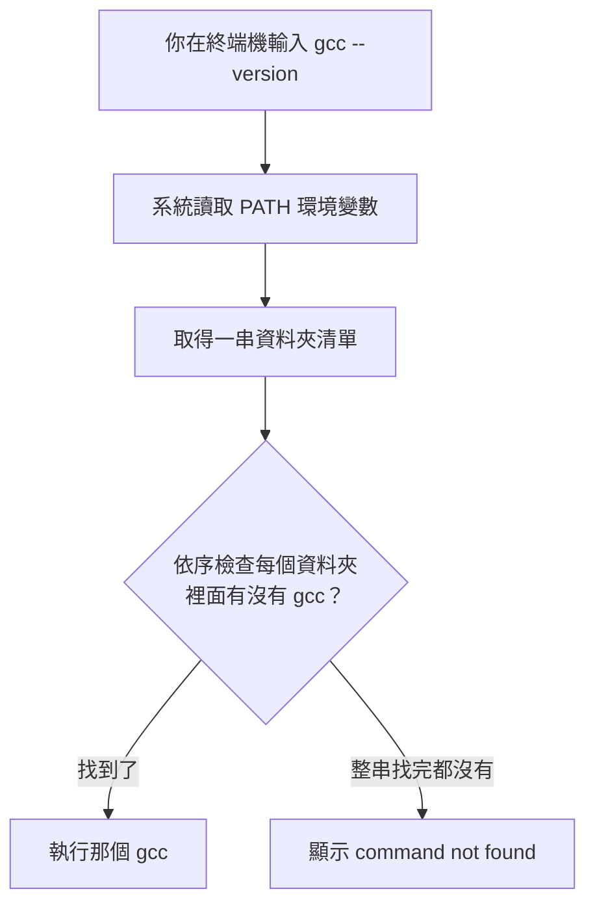
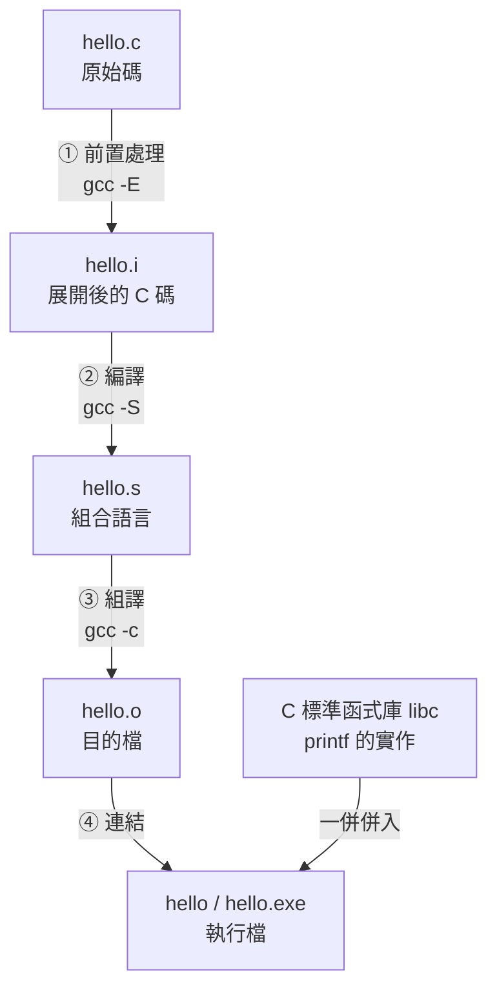
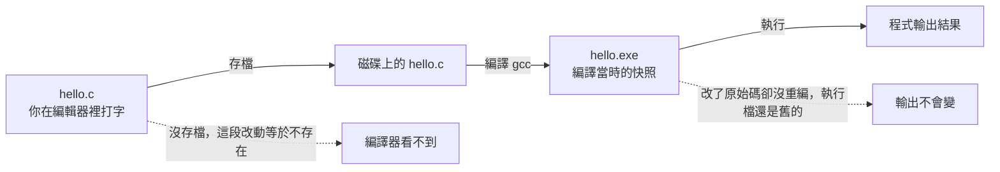
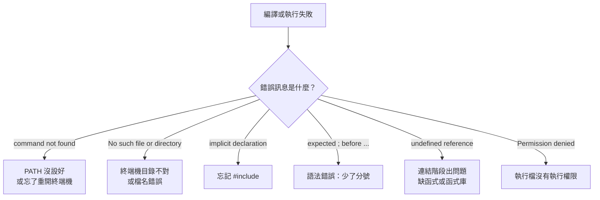

# 從安裝到執行：VS Code + GCC 的第一支 C 程式

## 學習目標

完成本節後，你應該能夠：

1. 說明「編輯器」與「編譯器」在程式開發中各自扮演的角色。
2. 在自己的電腦上完成 **VS Code** 與 **GCC** 的安裝。
3. 理解 **PATH 環境變數**的作用，並能自行把 GCC 加入 PATH、驗證設定成功。
4. 說出 GCC 將 `.c` 原始碼轉換為執行檔的**四個階段**，並能拆解 `gcc hello.c -o hello` 這個指令。
5. 獨立完成「撰寫 → 存檔 → 編譯 → 執行」的完整循環。
6. 修改 Hello World 的輸出內容，並**觀察、解釋**輸出結果的差異。
7. 看懂常見的編譯錯誤訊息，並知道從何處著手修正。

---

## 1. 先搞懂：寫程式需要哪些工具？

很多初學者第一個誤會是：「裝了 VS Code 就能寫 C 語言了嗎？」

**不行。** 這兩個工具負責的事情完全不同：

| 工具 | 角色 | 比喻 |
| --- | --- | --- |
| **VS Code** | 文字編輯器（editor），讓你打字、存檔、管理專案 | 紙和筆 |
| **GCC** | 編譯器（compiler），把 C 程式碼翻譯成電腦看得懂的執行檔 | 翻譯員 |

C 語言是**編譯式語言**（compiled language）：你寫的 `.c` 檔案只是純文字，電腦無法直接執行，必須先經過編譯器翻譯。


因此，**「編輯 → 存檔 → 編譯 → 執行」** 這個循環，就是你未來一整個學期要不斷重複的動作。

> **小提醒**：VS Code 的「執行 ▶」按鈕（若你安裝了相關擴充套件）只是幫你在背後呼叫 gcc。學會打指令，你才知道按鈕到底做了什麼。

---

## 2. 安裝開發環境

### 2.1 步驟一：安裝 GCC 編譯器

依你的作業系統選擇一種方式。

#### Windows

Windows 本身沒有內建 C 編譯器，建議以下兩種方式（選一種即可）：

**方式 A：MSYS2（推薦，套件管理方便）**

1. 到 [MSYS2 官網](https://www.msys2.org/) 下載安裝檔並安裝（預設路徑通常是 `C:\msys64`）。
2. 開啟 **MSYS2 UCRT64** 終端機，執行：
   ```bash
   pacman -S mingw-w64-ucrt-x86_64-gcc
   ```
3. 安裝完成後，gcc 會位於 `C:\msys64\ucrt64\bin`。**這個路徑等一下要加進 PATH**（見 2.2）。

**方式 B：MinGW-w64 免安裝壓縮包**

1. 下載 MinGW-w64（或 WinLibs 打包版）並解壓縮，例如放到 `C:\mingw64`。
2. gcc 會位於 `C:\mingw64\bin`。同樣要加進 PATH。

> [!SUPPLEMENT] mscOS 怎麼做
> #### macOS
> 
> 開啟「終端機」，執行：
> 
> ```bash
> xcode-select --install
> ```
> 
> 這會安裝 Command Line Tools，其中包含 `clang`（語法與 gcc 高度相容，實務上可直接用 `gcc` 指令）。用這種方式安裝的編譯器**已經在 PATH 裡**，不需要手動設定。

> [!SUPPLEMENT] Linux 怎麼做
> #### Linux（Ubuntu / Debian 系列）
> 
> ```bash
> sudo apt update
> sudo apt install build-essential
> ```
> 
> 透過套件管理員安裝的 gcc 會放在 `/usr/bin`，本來就是 PATH 的一部分，**不需要手動設定**。
> 
---

### 2.2 步驟二：把 GCC 加入 PATH（Windows 必讀）

#### 2.2.1 PATH 是什麼？為什麼需要設定它？

**PATH 是一個環境變數（environment variable）**，內容是一串「資料夾路徑」的清單。當你在終端機輸入一個指令名稱時，作業系統並不知道那個程式放在哪裡，於是它會**依序到 PATH 清單裡的每個資料夾尋找**同名程式。



也就是說：

- 若 `C:\msys64\ucrt64\bin` **不在** PATH 裡 → 系統找不到 gcc → 出現 `'gcc' 不是內部或外部命令`。
- 若它**在** PATH 裡 → 系統找到 gcc → 正常執行。

PATH 的內容格式，不同系統用不同符號分隔：

| 系統 | 分隔符號 | 範例 |
| --- | --- | --- |
| Windows | 分號 `;` | `C:\Windows\system32;C:\Windows;C:\msys64\ucrt64\bin` |
| macOS / Linux | 冒號 `:` | `/usr/local/bin:/usr/bin:/bin` |

> **重點觀念**：加進 PATH 的必須是**資料夾路徑**（例如 `C:\msys64\ucrt64\bin`），**不是** `gcc.exe` 這個檔案本身。

#### 2.2.2 Windows：圖形介面設定（推薦初學者）

1. 按一下 `Win` 鍵，輸入「**環境變數**」，選擇「**編輯系統環境變數**」。
2. 在彈出視窗的「**進階**」標籤頁，點選右下角的「**環境變數(N)...**」。
3. 在上方「**使用者變數**」區塊中，選取 `Path` 這一行，點「**編輯(E)...**」。
4. 點右側「**新增(N)**」，輸入 gcc 所在的資料夾，例如：
   ```
   C:\msys64\ucrt64\bin
   ```
5. 連續按「**確定**」關閉所有視窗（每一個視窗都要按到，設定才會被寫入）。
6. **關閉並重新開啟終端機**（這一步非常關鍵，原因見下方說明）。

**操作時的注意事項：**

- 加在「**使用者變數**」的 `Path` 即可，不需要動「系統變數」（改系統變數需要管理員權限，且影響全機）。
- **不要刪除清單中原有的任何項目**，那只會讓其他指令跟著壞掉。你只需要「新增」。
- 建議把新路徑**放在清單最後**；若同一個指令有多個版本，系統會採用**最前面**找到的那一個。

#### 2.2.3 Windows：命令列方式（進階）

如果你偏好用指令，可開啟 **PowerShell** 執行（僅在使用者層級追加）：

```powershell
$old = [Environment]::GetEnvironmentVariable("Path", "User")
[Environment]::SetEnvironmentVariable("Path", "$old;C:\msys64\ucrt64\bin", "User")
```

執行完同樣要**重開終端機**才會生效。

> **不建議用 `setx`**：`setx PATH "%PATH%;..."` 會把「系統變數 + 使用者變數」合併後寫回使用者變數，容易造成內容重複、膨脹，甚至超過 1024 字元而被截斷，反而弄壞原本的設定。

> [!SUPPLEMENT] mscOS / Linux 如何修改 shell 設定檔
> #### 2.2.4 macOS / Linux：修改 shell 設定檔
> 
> 雖然用 `xcode-select` 或 `apt` 安裝的編譯器通常不需設定 PATH，但學會這招對日後很有用。
> 
> 1. 先確認你使用的 shell：
>    ```bash
>    echo $SHELL
>    ```
> 2. 依結果編輯對應的設定檔：
> 
>    | shell | 設定檔 |
>    | --- | --- |
>    | zsh（macOS 預設） | `~/.zshrc` |
>    | bash | `~/.bashrc` 或 `~/.bash_profile` |
> 
> 3. 把新路徑**加到最前面**（這樣會優先被搜尋到）：
>    ```bash
>    echo 'export PATH="$HOME/.local/bin:$PATH"' >> ~/.zshrc
>    ```
> 4. 讓設定立刻生效：
>    ```bash
>    source ~/.zshrc
>    ```
> 
#### 2.2.5 設定完成後一定要驗證

```bash
gcc --version
```

**預期輸出**（版本號會不同，有出現即可）：

```
gcc (Rev1, Built by MSYS2 project) 13.2.0
Copyright (C) 2023 Free Software Foundation, Inc.
...
```

也可以查詢 gcc 實際位置：

| 系統 | 指令 | 預期結果 |
| --- | --- | --- |
| Windows | `where gcc` | `C:\msys64\ucrt64\bin\gcc.exe` |
| macOS / Linux | `which gcc` | `/usr/bin/gcc` |

若只列出一個路徑，代表系統只會用到這一個 gcc，乾淨明確。若列出多個，則**第一個**才是實際被執行的版本。

> **最常見的卡關：改完 PATH 卻沒用！**
> 環境變數是在**終端機啟動時**讀取的。設定完成後，務必**完全關閉舊的終端機視窗，再重新開一個**。
> VS Code 內建的整合終端機也算終端機，如果它是在你改設定之前就開著的，請**整個 VS Code 關掉重開**，或按 `Ctrl + Shift + P` 輸入 `Reload Window` 重新載入。

---

### 2.3 步驟三：安裝 VS Code 與必要擴充套件

1. 到 [VS Code 官網](https://code.visualstudio.com/) 下載對應你系統的版本並安裝。
2. 開啟 VS Code，點左側的**擴充套件（Extensions）**圖示（或按 `Ctrl + Shift + X`）。
3. 搜尋並安裝：
   - **C/C++**（發行者：Microsoft）— 提供語法著色、自動補全、錯誤提示。
   - **C/C++ Extension Pack**（選用）— 一次裝好常用相關套件。
   - **Code Runner**（選用）— 可一鍵執行；方便但底層仍是呼叫 gcc，建議仍要會手打指令。
4. 建議設定：開啟 `File > Open Folder`，**用「資料夾」為單位**開啟你的程式碼，而不是單開一個檔案。這會讓 VS Code 的終端機預設從該資料夾啟動，之後編譯指令才不會找不到檔案。

---

## 3. Hello World：你的第一支程式

### 3.1 建立工作資料夾與檔案

1. 建立一個資料夾，例如 `C:\cs101\hello`（macOS/Linux：`~/cs101/hello`）。
   - **建議路徑全用英文與底線，避免中文與空白**，可省下大量莫名的錯誤。
2. 在 VS Code 中 `File > Open Folder` 開啟這個資料夾。
3. 新增檔案 `hello.c`。
   - 注意副檔名必須是 `.c`。若 Windows 隱藏了副檔名，很容易不小心存成 `hello.c.txt`。

### 3.2 輸入程式碼

```c
#include <stdio.h>

int main(void) {
    printf("Hello, World!\n");
    return 0;
}
```

存檔（`Ctrl + S`）。**存檔是必須的動作**，編譯器讀的是硬碟上的檔案，不是你螢幕上看到的內容。

### 3.3 逐行解說

| 程式碼 | 意義 |
| --- | --- |
| `#include <stdio.h>` | 引入標準輸入輸出函式庫的標頭檔。`printf` 的宣告在這裡，沒有它編譯器不認識 `printf`。 |
| `int main(void)` | 主函式，**程式的進入點**。作業系統執行你的程式時，就是從 `main` 的第一行開始。`int` 表示它會回傳一個整數。 |
| `{` `}` | 包住 `main` 的程式區塊。 |
| `printf("Hello, World!\n");` | 把雙引號內的字串輸出到螢幕。`\n` 是換行符號。每個敘述結尾的 **分號 `;`** 不可省略。 |
| `return 0;` | 回傳 0 給作業系統，慣例上代表「程式正常結束」。 |

### 3.4 編譯與執行

在 VS Code 中按 ``Ctrl + ` ``（反引號）開啟整合終端機，確認目前目錄正確後執行：

```bash
gcc hello.c -o hello
```

- `gcc`：呼叫編譯器。
- `hello.c`：輸入的原始碼檔。
- `-o hello`：**o**utput，指定產出的執行檔名稱。

若沒有任何訊息輸出，代表**編譯成功**（在 Unix 哲學中，「沒有消息就是好消息」）。

接著執行：

| 系統 | 執行指令 |
| --- | --- |
| Windows（PowerShell） | `.\hello.exe` |
| Windows（命令提示字元） | `hello.exe` |
| macOS / Linux | `./hello` |

**預期輸出：**

```
Hello, World!
```

> **為什麼 Unix 系統要加 `./`？** 因為基於安全考量，macOS/Linux 預設不會在「目前資料夾」尋找可執行程式，`./` 是明確告訴系統「就是這個資料夾裡的 hello」。

---

## 4. GCC 編譯流程：從 `.c` 到執行檔

`gcc hello.c -o hello` 這一行，其實包含了**四個階段**。GCC 把它們串在一起一次做完。

### 4.1 四個階段

| 階段 | 英文 | 做什麼 | 單獨執行的指令 | 產物 |
| --- | --- | --- | --- | --- |
| 1. 前置處理 | Preprocessing | 展開 `#include`、處理 `#define` 與條件編譯、移除註解 | `gcc -E hello.c -o hello.i` | `hello.i`（展開後的 C 碼） |
| 2. 編譯 | Compilation | 把 C 碼翻譯成組合語言（assembly） | `gcc -S hello.c -o hello.s` | `hello.s`（組合語言） |
| 3. 組譯 | Assembly | 把組合語言翻譯成機器碼，產生目的檔 | `gcc -c hello.s -o hello.o` | `hello.o`（目的檔） |
| 4. 連結 | Linking | 把目的檔與函式庫（如 `printf` 所在的 C 標準函式庫）合併，產生執行檔 | `gcc hello.o -o hello` | `hello` / `hello.exe` |

用圖表示這條生產線：



**為什麼要理解這個？**

- 之後遇到 `undefined reference to ...` 這類錯誤，你會知道問題出在**第 4 階段（連結）**，而不是語法寫錯。
- 大型專案會把多個 `.c` 分別編成 `.o`，最後再一起連結；只改一個檔案時就不必重編全部。

### 4.2 常用編譯選項速查

| 選項 | 作用 | 建議 |
| --- | --- | --- |
| `-o <名稱>` | 指定輸出檔名 | 幾乎每次都用 |
| `-Wall` | 開啟大多數警告 | **強烈建議每次加** |
| `-Wextra` | 開啟額外警告 | 建議 |
| `-std=c11` | 指定使用 C11 標準 | 課程若指定標準時使用 |
| `-g` | 產生除錯資訊，供除錯器使用 | 需要除錯時 |
| `-O2` | 開啟最佳化 | 效能測試時 |
| `-c` | 只做到組譯，產生 `.o` | 多檔案專案 |
| `-E` / `-S` | 只到前置處理 / 編譯階段 | 觀察中間產物 |
| `-v` | 顯示 GCC 詳細執行過程 | 疑難排解 |

本課程建議的標準編譯指令：

```bash
gcc -Wall -Wextra -std=c11 hello.c -o hello
```

---

## 5. 修改輸出，觀察差異

接下來是重點：**動手改，然後觀察。**

每次修改後，請確實執行這個循環：


### 實驗一：改變文字內容

```c
#include <stdio.h>

int main(void) {
    printf("哈囉，計算機概論！\n");
    return 0;
}
```

**觀察重點：** 只有雙引號內的字串變了，其餘程式結構完全不動。體會「**字串是資料，程式結構是邏輯**」。

### 實驗二：一個 `printf` vs 多個 `printf`

版本 A：

```c
printf("第一行\n第二行\n");
```

版本 B：

```c
printf("第一行\n");
printf("第二行\n");
```

**觀察重點：** 輸出結果**完全相同**。可見「怎麼排版」和「輸出什麼」是兩件事；`printf` 是「逐次呼叫、依序輸出」。

### 實驗三：拿掉 `\n` 會怎樣？

```c
#include <stdio.h>

int main(void) {
    printf("Hello");
    printf("World");
    return 0;
}
```

**預期輸出：**

```
HelloWorld
```

再改成：

```c
printf("Hello\n");
printf("World\n");
```

**觀察重點：**

- `\n` 是**換行字元**，不是「印出反斜線和 n」。它是所謂的**跳脫序列（escape sequence）**。
- 若程式最後一行沒有 `\n`，在 macOS/Linux 上你可能看到終端機提示字元緊接在輸出後面，例如 `HelloWorlduser@pc:~$`，看起來很擠。風格上建議每段輸出結尾都加 `\n`。

其他常見跳脫序列試試看：

| 寫法 | 效果 |
| --- | --- |
| `\n` | 換行 |
| `\t` | 定位點（Tab），可用來對齊 |
| `\\` | 印出一個反斜線 `\` |
| `\"` | 印出一個雙引號 `"` |

例如：

```c
printf("姓名\t學號\n");
printf("王小明\tB12345678\n");
```

### 實驗四：改了卻沒變？——最常見的新手困惑

請刻意做一次這個實驗：

1. 把字串改成 `"版本二"`，**存檔**，重新編譯、執行 → 看到 `版本二`。
2. 再把字串改成 `"版本三"`，**但不存檔**，直接重新編譯、執行 → 仍然看到 `版本二`。
3. 存檔後**不重新編譯**，直接執行 → 還是看到 `版本二`。



**觀察重點：**

- 編譯器讀的是**磁碟上的檔案**，不是編輯器畫面上的內容。未存檔的修改等於沒改。
- 執行檔是**編譯當時的快照**。程式的生命週期是「原始碼 → 編譯 → 執行檔 → 執行」。
- 改完原始碼一定要**重新編譯**，執行檔才會更新。

### 實驗五：中文輸出與編碼

把輸出改成中文後，若終端機顯示為亂碼（例如 `嚙踝蕭`），通常是**編碼不一致**造成：

- 確認原始碼檔案本身存成 **UTF-8**（VS Code 右下角可看到並切換編碼）。
- Windows 舊版命令提示字元（cmd）預設使用 Big5（CP950），可先在 cmd 中執行 `chcp 65001` 切換為 UTF-8，或改用 **Windows Terminal / PowerShell**。
- 這類問題屬於**環境設定**，不是程式邏輯錯誤。記錄下你遇到的狀況與解法，這正是軟體開發的日常。

---

## 6. 常見錯誤與疑難排解



| 錯誤訊息 / 現象 | 可能原因 | 解決方式 |
| --- | --- | --- |
| `'gcc' 不是內部或外部命令` / `gcc: command not found` | 未安裝 GCC，或 PATH 未設定，或設定後未重開終端機 | 回到 2.1、2.2 重新安裝與設定 PATH，**完全關閉並重開終端機** |
| `gcc: error: hello.c: No such file or directory` | 終端機目前目錄不是檔案所在資料夾 | 用 `cd` 切換目錄，或用 VS Code 開啟整個資料夾 |
| `warning: implicit declaration of function 'printf'` | 忘記 `#include <stdio.h>` | 在檔案最上方加入 `#include <stdio.h>` |
| `error: expected ';' before ...` | 上一行少了分號 | 檢查每個敘述結尾的 `;` |
| `error: stray '\' in program` | 跳脫序列寫錯（例如 `\n` 寫成 `\N`） | 確認跳脫序列拼法 |
| `undefined reference to 'main'` | 沒有 `main` 函式，或檔名／函式名稱打錯 | 確認 `int main(void)` 存在且拼字正確 |
| 編譯一直找不到檔案 | 檔名其實是 `hello.c.txt` | 在檔案總管開啟「顯示副